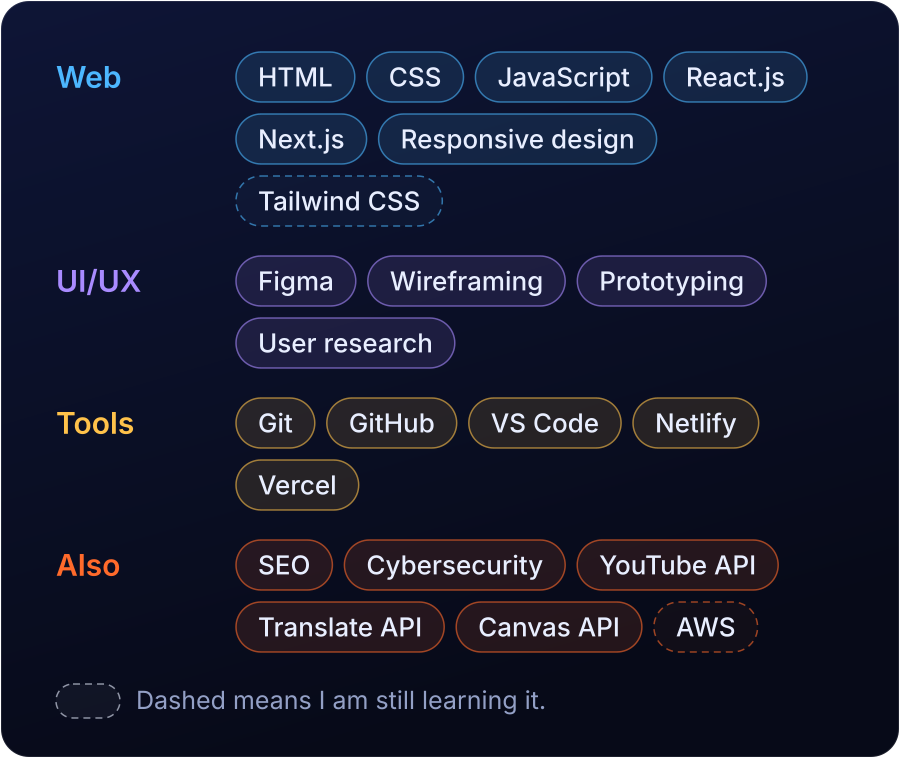
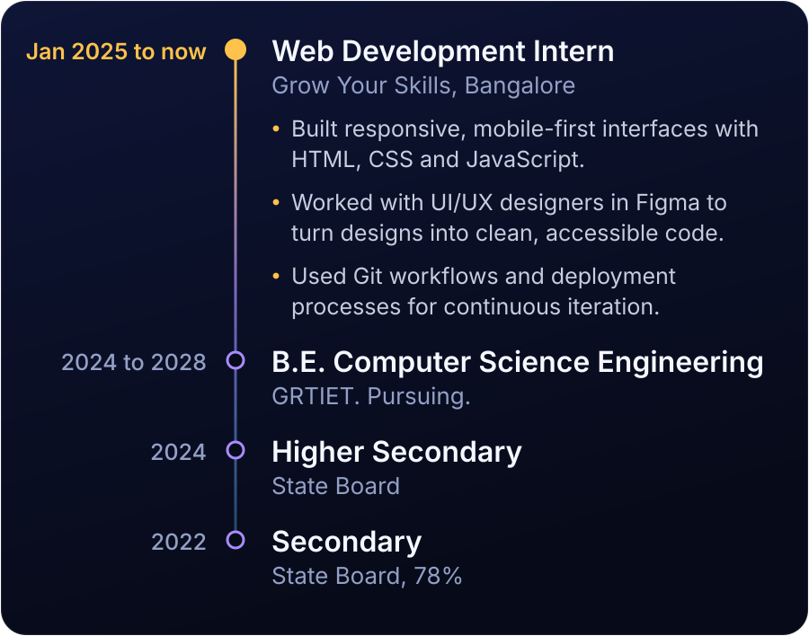
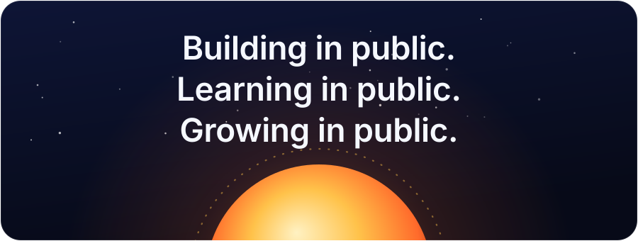

  

  
  
  
  

I'm Shyam, a B.E. Computer Science student at GRTIET (2024 to 2028) in Tiruttani, Tamil Nadu, and a Web Development Intern at Grow Your Skills, Bangalore. I build responsive, user-friendly web apps with clean code and intuitive UI/UX design, and I build most of them on my phone. I'm looking for a Frontend or UI/UX internship where I can keep growing **StudyVault World**. I speak Tamil (native) and English (professional).

  

  

  

  

  

  

  

**Source code:** [StudyVault World](https://github.com/shyamkalt/studyvault-world), [ApplyWorld](https://github.com/shyamk-alt/applyworld), [Shyam's CSE Pro](https://github.com/shyamk-alt/todoapp), [MovieFlix](https://github.com/shyamkalt/movie-search), [WeatherFlix](https://github.com/shyamkalt/weatherflix), [Portfolio](https://github.com/shyamk-alt/portfolio)

  

  

  

  

**Certifications (Coursera):** Microsoft AI Foundations, Google Cybersecurity and Python, IBM SEO Content Marketing, HKUST Python Statistics and AWS Data Engineering. All my badges are on [Credly](https://credly.com/users/shyamk.bd0525c1).

  <picture>
    <source media="(prefers-color-scheme: dark)" srcset="https://raw.githubusercontent.com/shyamk-alt/shyamk-alt/output/github-snake-dark.svg">
    
  </picture>

  

